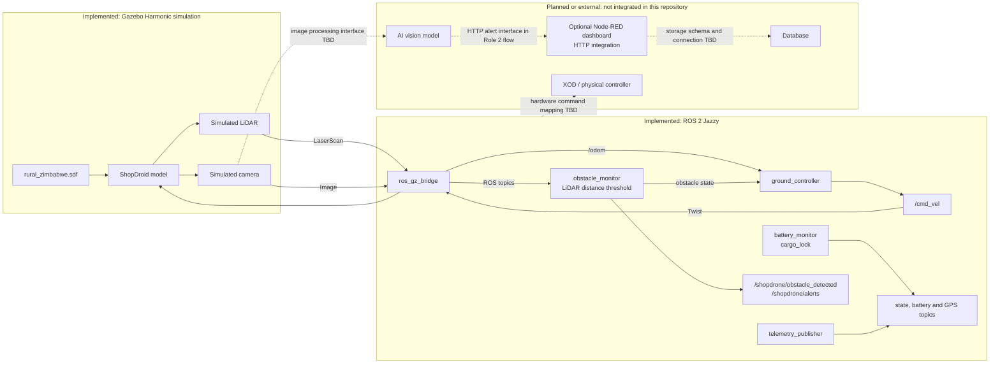

# Egrocca System Architecture

This diagram separates what is present in the repository from systems that still need hardware or team confirmation.

Solid arrows show the current simulation's data/control paths. Dashed arrows are proposed integration points, not working hardware connections. In particular:

- The repository's `obstacle_monitor.py` is a LiDAR range-threshold node; it is not an AI model.
- The ROS/Gazebo bridge exposes simulated sensor messages and drive commands. It does not configure physical sensor drivers.
- The Node-RED dashboard is an optional HTTP integration, not a ROS node. A vision/ROS client must forward alerts to it; the current launch files do not connect to Node-RED.
- No XOD project, database service/schema, or hardware command mapping is present here. Confirm their intended roles and protocols with the team before treating the dashed links as final.

## Physical wiring diagram status

A pin-accurate Fritzing diagram cannot be made from the simulation files alone. The repository does not specify the physical controller board, sensor models, motor drivers, battery/power regulators, pin assignments, or connector types. Do not infer electrical wiring from the simulated SDF sensor poses.

Before creating the Fritzing file, collect and confirm:

| Required information | Record before drawing |
|---|---|
| Controller and compute unit | Board model, revision, logic voltage, pinout |
| Sensors | Camera and LiDAR models, interfaces, supply voltage, current, connectors |
| Drive system | Motors, motor-driver models, ratings, control and feedback pins |
| Power | Battery chemistry and voltage, fuses, regulators, grounding and emergency stop |
| Wiring | Connector/pin numbers, cable type, colors, and any level shifting |

Once the prototype is available and the design is reviewed by the hardware team, commit the editable Fritzing project and an exported image/PDF under `docs/`. Label power rails, grounds, connectors, and pin numbers, and include the approved component list. Until then, mark this deliverable as pending rather than publishing a speculative wiring diagram.
