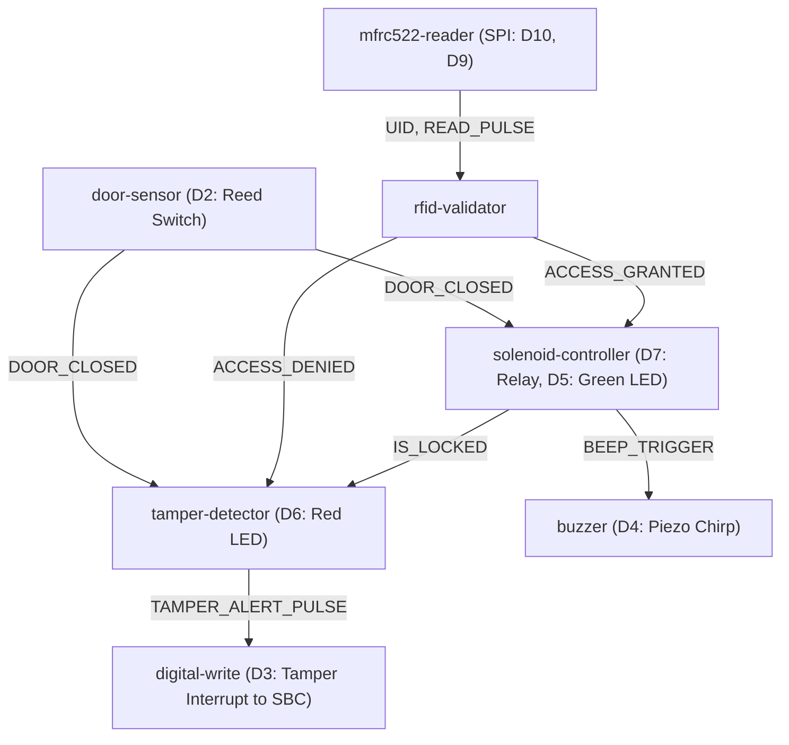

# Electronic Compartment Lock & Anti-Tamper System (XOD Visual Patches)

This subsystem controls the secure cargo compartment for the rural delivery droid. When arriving at a customer's homestead or pickup station, the recipient unlocks the compartment by scanning their registered RFID card, key fob, or NFC smartphone token.

---

## 1. System Architecture & Component Interaction

```
[Customer RFID/NFC Tag]
          │ (13.56 MHz RF Field)
          ▼
   ┌──────────────┐
   │ MFRC522      │ SPI Bus (D9, D10, D11, D12, D13)
   │ RFID Reader  ├────────────────────────┐
   └──────────────┘                        ▼
                                ┌─────────────────────┐
[Door Reed Switch D2]──────────►│                     │──────► [12V Solenoid Lock (D7)]
                                │  XOD / Micro-       │──────► [Green LED D5 (Unlock)]
[Serial Remote Auth from SBC]──►│  controller Patch   │──────► [Red LED D6 (Tamper)]
                                │                     │──────► [Piezo Buzzer D4 (Audio)]
                                └──────────┬──────────┘
                                           │ Pin D3 (Tamper Interrupt)
                                           ▼
                                [Droid SBC / Node-RED Telemetry]
```

---

## 2. XOD Visual Patch Architecture

The logic is partitioned into clean, modular XOD patches:

### Patch 1: `main.xodp` (Master Coordinator)


### Patch 2: `rfid-validator.xodp`
Compares the scanned hexadecimal UID string against the currently authorized customer UID (`AUTH_UID`).
- **Nodes**: `input-string` (Scanned UID), `input-pulse` (On Read), `input-string` (Authorized UID), `equal` (String Match), `branch` (Conditional router).
- **Outputs**:
  - `ACCESS_GRANTED`: Emitted when UID matches.
  - `ACCESS_DENIED`: Emitted when UID does not match.
  - `IS_VALID`: Boolean indicator.

### Patch 3: `solenoid-controller.xodp`
Drives the 12V DC solenoid latch with built-in thermal coil protection:
- **Flip-Flop Memory**: Latches to `HIGH` upon receiving `UNLOCK_TRIGGER`.
- **Delay Timer**: Counts down `HOLD_TIME_SEC` (default: 10–12 seconds).
- **Reed Switch Sync**: When customer closes the lid, or when the failsafe timer expires, the flip-flop resets to `LOW`, de-energizing the solenoid and engaging the mechanical spring bolt.
- **Indicators**: Illuminates Green LED (D5) and chirps the buzzer (D4).

### Patch 4: `tamper-detector.xodp`
Monitors for brute-force attacks and physical pry attempts:
- **Scan Brute-Force**: Counts consecutive denied RFID scans using `count`. If count reaches $\ge 3$, raises `TAMPER_ALERT`.
- **Physical Pry Detection**: If `IS_LOCKED` is TRUE and `DOOR_CLOSED` becomes FALSE (the door is pried open without an electronic unlock pulse), raises `TAMPER_ALERT` immediately!
- **Alarm Actions**: Pulses Red LED (D6), triggers warble buzzer alarm, and sets Pin D3 `HIGH` to wake the Droid Companion SBC and push a critical tamper message to Node-RED.

---

## 3. Hardware Wiring & Pinout Guide

| Pin | Component | Direction | Description |
| :--- | :--- | :--- | :--- |
| **D10** | MFRC522 SDA (SS) | Output | SPI Slave Select |
| **D13** | MFRC522 SCK | Output | SPI Clock |
| **D11** | MFRC522 MOSI | Output | SPI Master Out Slave In |
| **D12** | MFRC522 MISO | Input | SPI Master In Slave Out |
| **D9** | MFRC522 RST | Output | Reset pin for RFID |
| **D7** | Solenoid Relay / MOSFET | Output | Active HIGH to energize 12V Solenoid |
| **D5** | Green LED | Output | Access Granted Indicator (with 220Ω resistor) |
| **D6** | Red LED | Output | Access Denied / Tamper Alert (with 220Ω resistor) |
| **D4** | Active Piezo Buzzer | Output | Acoustic Feedback & Alarm Siren |
| **D2** | Magnetic Reed Switch | Input | `INPUT_PULLUP`. Pulls to GND when door closed |
| **D3** | Tamper Signal Line | Output | 3.3V/5V logic signal to Droid Companion SBC GPIO |
| **3.3V** | MFRC522 VCC | Power | **CAUTION:** MFRC522 requires 3.3V (NOT 5V!) |
| **5V / 12V** | Relay & Solenoid | Power | 12V DC auxiliary battery rail for Solenoid Lock |

> [!CAUTION]
> Always place a **flyback diode (e.g. 1N4007 or 1N5819)** in reverse parallel across the 12V solenoid coil terminals. Inductive flyback spikes when de-energizing can otherwise damage the switching transistor or microcontroller!

---

## 4. How to Use & Deploy

### Option A: Using XOD IDE
1. Download and launch [XOD IDE](https://xod.io/).
2. Click **File -> Open Project** and navigate to `xod_compartment_lock/project.xod`.
3. The patches (`main.xodp`, `rfid-validator.xodp`, `solenoid-controller.xodp`, `tamper-detector.xodp`) will appear in your project hierarchy.
4. Select your board (e.g., `Arduino Uno` or `Arduino Nano`) and port.
5. Click **Deploy -> Upload**.

### Option B: Using the Arduino C++ Firmware
If flashing without the XOD IDE:
1. Open `xod_compartment_lock/arduino_implementation/compartment_lock.ino` in the Arduino IDE or VS Code with PlatformIO.
2. Install the `MFRC522` library via the Library Manager.
3. Select your board and COM port.
4. Upload the sketch.
5. Open Serial Monitor at **115200 baud** to view real-time lock status and dynamic token updates.

